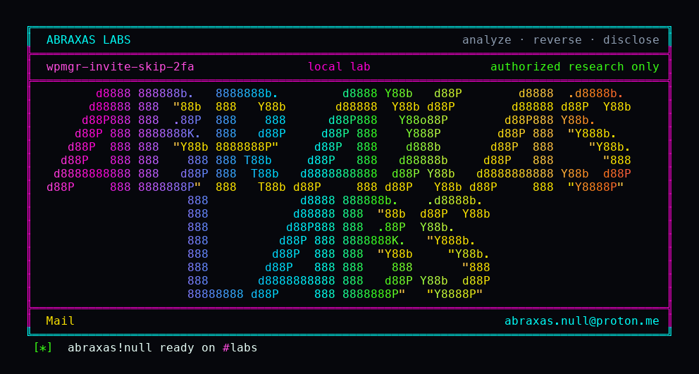

<p align="center">
  
</p>

# wpmgr-invite-skip-2fa

If someone already stole your WPMgr password, 2FA is supposed to stop them. It does, on the login box. It does not on an invitation. They invite your address into an organisation they own, then accept that invite with your password and no authenticator code. WPMgr hands them a full session as you, 2FA still marked on. From that session they can switch into your other organisations.

**Class:** Auth leftover (2FA bypass)
**Reach:** Remote (stolen password plus an org the attacker already owns)

**WPMgr** `v0.61.199` (`e1b3a163`) - mosamlife

| | |
|---|---|
| ID | no CVE yet |
| Class | **Auth leftover** (invitation accept skips the 2FA session gate) |
| Reach | **Remote** (attacker-owned org + victim password) |
| CWE | [CWE-287](https://cwe.mitre.org/data/definitions/287.html) |
| CVSS | **High: 8.1** `CVSS:3.1/AV:N/AC:L/PR:L/UI:N/S:U/C:H/I:H/A:N` |
| Product | [WPMgr](https://github.com/mosamlife/wpmgr) |
| Affected | **v0.61.199** (`e1b3a163988c9f1c31bc93922ea34322fa188792`) |
| Auth | attacker account with member-invite; victim password; no TOTP |
| License | [GNU Affero GPL v3.0](LICENSE) |
| Lab | loopback 127.0.0.1:18190-18196. Compose `wpmgrh05`. |

## What an attacker can do

Needs an organisation they already own (self-serve after claim) and the victim's password. The victim does not have to open mail. `POST /api/v1/members` returns the raw accept token in JSON.

| Privilege | Method / sink | Recon / integrity / availability | Lab-proven or inferred |
|---|---|---|---|
| Mint an invite token for the victim without mail | `POST /api/v1/members` `{email, role}` returns `accept_link` | Recon (token) | Lab-proven. 64-char token |
| Password login still challenges 2FA | `POST /auth/login` email + password, no TOTP | n/a (negative) | Lab-proven. 202 `two_factor_required`, no session |
| Session as the victim with no TOTP | `POST /api/v1/invitations/accept` token + password | Integrity (authn) | Lab-proven. 200, `wpmgr_session`, not `two_factor_required` |
| Confirm 2FA is still enrolled on that user | `GET /auth/me` | Recon | Lab-proven. `two_factor_enabled=true` |
| Switch the stolen session into the victim's org | `POST /api/v1/orgs/{victimOrg}/activate` | Integrity (tenant switch) | Lab-proven. 200 |

**Stays closed on this leftover**

| Axis | Method / sink | Why it is closed |
|---|---|---|
| Integrity | Password login, SSO, email verify, bootstrap | ADR-056 B2 `issueSessionOrChallenge` |
| Integrity | Password reset | Does not mint a session; revokes trusted devices |
| Integrity | SSO-only victim (empty `password_hash`) | Accept refuses this path |
| Integrity | Unauthenticated with no stolen password | Accept still `VerifyPassword`s |

The login box and the invite accept path do not share a session helper. I only noticed because the 2FA tests pin B2 on login, OIDC, verify, and bootstrap, and invitation is not in that list.

## How I found it

`invitation.Service.Accept` calls `SessionManager.Login` after `VerifyPassword`. Authenticator never re-checks TOTP. `X-Tenant-ID` / `POST /orgs/{id}/activate` then walks every org the victim already belongs to.

Wrong turns: treating password reset as a sibling issuer (it is deliberately session-less); treating site-share / client-portal accept as the same ATO (org invite is the one that becomes the victim user).

## Lab

```bash
python3 wpmgr-invite-skip-2fa-Abraxas-Labs.py
```

or:

```bash
cd lab
./run.sh
```

Clones [mosamlife/wpmgr](https://github.com/mosamlife/wpmgr) at `e1b3a163` into `lab/src` and reuses `wpmgr-lab:v0.61.199` when present. Loopback only.

```text
IOC login-password-only status=202 two_factor_required=True session=False
IOC accept-without-totp status=200 two_factor_required=False session=True
IOC accept-me status=200 email=victim@example.com two_factor_enabled=True
IOC activate-victim-org status=200
SUCCESS WPMGR-H05-INVITE-2FA invite-accept-skipped-2fa-session WPMGR-H05-SESSION-WITHOUT-2FA
```

## The fix

Route invitation accept through `issueSessionOrChallenge`. If `TwoFactorEnabled` is set, return 202 and hold the pending accept until a TOTP (or recovery) succeeds. Stop returning raw `accept_link` tokens in member-create JSON if mail is the intended channel.

## References

- [github.com/mosamlife/wpmgr](https://github.com/mosamlife/wpmgr) `e1b3a163988c9f1c31bc93922ea34322fa188792`
- [`invitation.Service.Accept`](https://github.com/mosamlife/wpmgr/blob/e1b3a163988c9f1c31bc93922ea34322fa188792/apps/api/internal/invitation/service.go)
- [`issueSessionOrChallenge`](https://github.com/mosamlife/wpmgr/blob/e1b3a163988c9f1c31bc93922ea34322fa188792/apps/api/internal/auth/handler.go)
- [CWE-287](https://cwe.mitre.org/data/definitions/287.html)

## License

GNU Affero GPL v3.0. See [LICENSE](LICENSE). Loopback lab only. No warranty.

Abraxas Labs
abraxas.null@proton.me
